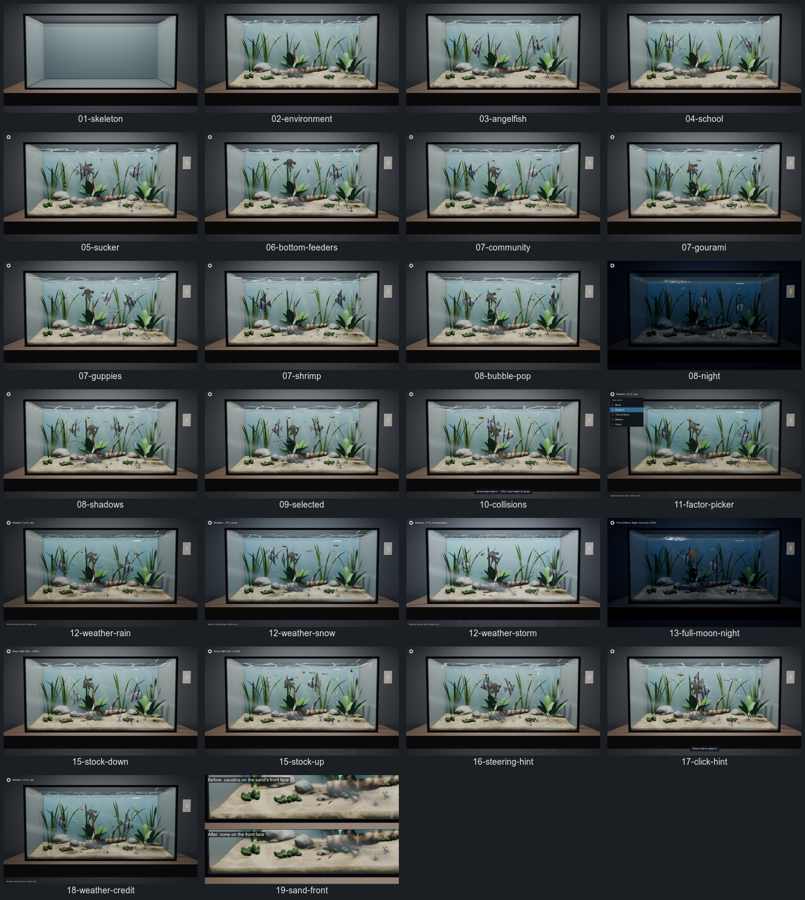

# tankful

A desktop aquarium built on the [UPBGE](https://upbge.org) game engine:
a glass tank of fish that swim, school and react, with lighting that can
follow the weather, the moon, your battery or the stock market.  It runs
on macOS, Linux and Windows.

## How it was built

AI agents (Claude Code) wrote all of tankful from one prompt, working
inside Wing Pro 12.1, a Python IDE from [Wingware](https://wingware.com/).
Wing's Tasks Manager is itself an AI agent: it turns a request into a
queue of tasks, gives each to a separate coding agent, answers their
questions, checks and commits their work, and starts the next.  Here it
split the prompt into steps and ran them up to five at a time; the agents
made their own judgement calls, filed the problems they found as new
tasks, took the screenshots in `docs/shots/` with the test harness they
built, and each finished piece of work became a commit here.  The run
took about 11 hours: 10 hours on October 16, 2026, from 1:13 pm to
11:08 pm, and an hour the next morning for three refinements.  It made
68 tasks and 49 commits.

This was the prompt that started it:

> I want to create a desktop aquarium app called tankful in Python for
> macOS, Linux, and Windows, using the UPBGE game engine. It shows a fish
> tank with plants, sand, bubbles, and light playing through the water,
> and several kinds of fish that look and move like real ones: a school
> that swims together, a sucker that clings to the front glass, bottom
> feeders that sift the sand, and a few others. A light switch turns the
> tank to night, affecting fish behavior. I should be able to click a fish
> or a school to make it current (about 10% larger with a faint yellow
> outline) and steer it with the arrow keys. When no keys are down, it
> returns to swimming normally. When fish collide they should swim away
> from each other, in the case of one being steered by the user only the
> other fish swims away. The tank can also reflect external factors, which
> the viewer picks while it runs: the weather outside, the time of day and
> moon phase, the computer's battery level (swimming speed), or whether
> the stock market is up or down today (height of swimming). Once the main
> entry point exists, set it up in Wing as the main entry point so I can
> test/debug it.  Run all tasks to completion except small details and
> ideas for future improvements.
>
> Commit a screenshot of each major visual change under docs/shots/ since
> we'll be creating a publishable trace of this run later.

The next morning, these three prompts refined it:

> When I click on and steer a fish, it should move faster than it does
> naturally.

> The shadows of the light from the surface of the water show up also on
> the front surface of the sand, which makes no sense because it would
> not have the light from the top shining on it

> The plants don't move at all, which doesn't look realistic since there
> would be at least some slow currents in the water, particularly due to
> any filter pumping water through.

[run-trail/RUN.md](run-trail/RUN.md) is the run's full trail: every
task with its prompt, the questions and who answered them, the judgement
calls, the findings filed, the commits and screenshots, and the time
and tokens each used, followed by what went wrong along the way.
[run-trail/trail.json](run-trail/trail.json) has the same data.

The tank has a sloping sand bed, rocks and driftwood, vallisneria,
Amazon swords and moss swaying in the current of a hang-on-back filter
pouring in at the back, an airstone's bubble stream whose
bubbles pop in rings on the surface, moving caustics with a shimmering
surface, soft god rays, and a light switch on the wall.  Thirty-five
animals of seven kinds live in it:

- **Angelfish** (2) glide slowly around the decor, bank into turns, and
  now and then hover on their fins.
- **Neon tetras** (15) swim as one school through the open water: it
  turns together, flows round the decor, and now and then one of them
  flicks aside and darts back.
- **A bristlenose pleco** clings to the front glass with its belly to
  the viewer, its sucker mouth rasping as it inches along; now and then
  it lets go, darts to another spot on the glass, a rock or the sand,
  and clings again.
- **Panda corydoras** (5) sift the sand, hop, rest and dash up for air.
- **Guppies** (6) keep near the top in a quick shoal, the males chasing
  the females.
- **Honey gouramis** (2), a slow pair near the surface, probe with their
  feelers.
- **Cherry shrimp** (5) pick at the sand and the moss.

Each fish casts a soft shadow on the sand, and fish that bump into each
other dart apart.

The contact sheet above has every screenshot in
[docs/shots/](docs/shots/), one or more per step of the build; each was
taken by the test harness (below) with the script of the same name in
`tools/scripts/`.

## Install

You need:

- **Python 3.11 or later** for the launcher and tools.  They use only
  the standard library, so any Python works.  The game itself runs in
  UPBGE's own bundled Python 3.11.
- **UPBGE 0.50**, which `tools/fetch_upbge.py` downloads (free, no
  account), about 650 MB on macOS, 400 MB on Linux and 300 MB on
  Windows.  It checks the archive against the size and sha256 published
  for the release and unpacks it into `vendor/upbge/<os>/`:

      python tools/fetch_upbge.py                    # this OS
      python tools/fetch_upbge.py --platform linux   # for the docker backend

- **A GPU and driver that run Blender 5.0**, which UPBGE 0.50 is built
  on.  Without one, the docker backend renders in software (slowly).

To use an UPBGE installed elsewhere, set `TANKFUL_UPBGE` to its
directory, app bundle or binary.  Otherwise the launcher looks in
`vendor/upbge/<os>/`, then in `/Applications/UPBGE`,
`~/Applications/UPBGE`, `/opt/upbge`, `~/upbge` or
`%ProgramFiles%\UPBGE`.

### macOS

Apple Silicon (UPBGE publishes only an arm64 build).  `fetch_upbge.py`
mounts the dmg read-only and copies its apps out.  If HTTPS fetches fail
with certificate errors under a python.org Python, run its "Install
Certificates" step; the game itself carries its own CA handling
(`tankful/factors/net.py`).

### Linux

x86-64.  `fetch_upbge.py` unpacks the `.tar.xz`.  The player needs the
usual X11/Wayland, OpenGL and sound libraries (the list in
`tools/docker/Dockerfile` is a known-good set for Ubuntu 24.04), and it
crashes on start when it can open no audio device at all, so a machine
with no sound server needs one with a null sink
(`pulseaudio -D --exit-idle-time=-1` does it).  The harness's default
Linux backend needs `Xvfb` (the `xvfb` package).

### Windows

Not yet run on Windows (there was no Windows machine to try it on), so
these steps are untested:

1. Install Python 3.11 or later from python.org, with "Add python.exe
   to PATH" ticked.  Nothing else needs installing with pip.
2. Get the code, open a terminal (PowerShell or cmd) in its folder, and
   fetch UPBGE:

       py tools\fetch_upbge.py

   It unpacks the `.7z` with `7z` or `7za` if one is on PATH, else with
   the `tar.exe` that comes with Windows 10 and later.
3. Run it:

       py run_tankful.py

The settings file is `%APPDATA%\Tankful\settings.json`, and the Battery
factor reads the charge through `GetSystemPowerStatus`.  The things most
likely to need fixing on a first run:

- The harness's default Windows backend, `offscreen`, moves the player's
  window off the desktop through user32
  (`tankful/game/offscreen_windows.py`), which has never run.  If its
  screenshots come out black or the window shows, try
  `--backend window` to check the game itself, then the docker backend
  (Docker Desktop with the WSL 2 engine), which runs the Linux build.
- When a harness run has to stop a game that will not quit, it
  terminates `run_tankful.py`, which on Windows ends it without letting
  it stop the player first; check Task Manager for a leftover
  `blenderplayer.exe`.

## Running

    python run_tankful.py

This rebuilds `build/tankful.blend` from `tools/build_scene.py` when it
is missing or older than that script or the other sources it is made
from (`launcher.SCENE_SOURCES`), then starts the UPBGE player.  The first
build takes a minute or so.  Options:

- `--rebuild`: rebuild the scene even if up to date.
- `--backend window|offscreen|xvfb|docker`: `window` (the default) is
  an ordinary window; the others run without a visible window (see
  [docs/harness.md](docs/harness.md)).
- `--harness PORT`: accept harness commands on localhost:PORT.
- `--debug`: debug game code in Wing.  Copy `wingdbstub.py` from your
  Wing install into the project root first.

`TANKFUL_WINDOW=WIDTHxHEIGHT` changes the window size from 1280x720.  In
Wing, `run_tankful.py` is the main entry point, and `build-scene` and
`harness` are named entry points.

## Controls

| Control | Does |
|---|---|
| Click a fish | Makes it current: drawn a little larger with a faint yellow outline.  A school, the guppies, the corydoras or the shrimp are selected as a group. |
| Arrow keys | Steer the current fish across the tank and up and down.  Let go and it eases back to swimming on its own. |
| Click open water | Deselects. |
| Light switch on the wall, or L | Fades the tank to night over a few seconds, and back. |
| Gear at the top left, or F | Opens the factor menu: pick with a click, a number key (1 None, 2 Weather, 3 Time & Moon, 4 Battery, 5 Stock), or the arrows and Enter.  F, the gear or a click elsewhere closes it. |
| Escape | Quits. |

Two hints at the bottom of the window show a new viewer the way in:
until the first fish is selected, one says to click a fish to select
it; then, the first time one is, another says the arrow keys steer it
and a click on open water lets it go
([docs/shots/16-steering-hint.png](docs/shots/16-steering-hint.png)).
Each fades out after a few seconds and is not shown again in that run.

At night the fish settle: the tetras rest low, the angelfish and
gouramis hover by the plants and the guppies under the surface, while
the corydoras, the pleco and the shrimp get busier.

## Factors

A factor ties the tank's mood to something outside it.  The label beside
the gear shows the picked factor and its live value, or *offline* when
its source can't be reached, in which case the tank stays as it would
under None.  The choice is kept in a per-user settings file
(`settings.json` in `~/Library/Application Support/Tankful/` on macOS,
`%APPDATA%\Tankful\` on Windows, `~/.config/tankful/` on Linux).

| Factor | What it changes | Refreshed |
|---|---|---|
| None | Nothing: the tank as built. | |
| Weather | The local weather.  Clear: bright light, sharp caustics.  Cloudy or fog: dimmer, softer light.  Rain: drops and rings on the surface, darker light, the fish lower.  Snow: a cool tint and slower fish.  Storm: lightning that startles the fish, and a rough surface. | every 15 minutes |
| Time & Moon | The real day where you are: the light warms and dims as the sun goes down, switches itself off at sunset and on at sunrise (flip the switch yourself and it stays that way until the next one), and at night the moon's phase sets how bright the moonlight is, with the moon glinting on the surface. | every minute |
| Battery | The computer's charge: full is normal speed, and the fish grow sluggish as it runs down.  With no battery (a desktop) the label says so and the tank stays neutral. | every minute |
| Stock | Today's S&P 500 change: up days lift the fish toward the surface and down days sink them toward the sand. | every 10 minutes while the US market is open |

Each factor keeps optional settings under its own key in
`settings.json`, which you can edit while tankful is closed:

    {"version": 1, "factor": "weather",
     "weather": {"lat": 42.36, "lon": -71.06, "place": "Boston", "units": "F"},
     "moon": {"lat": 42.36, "lon": -71.06}}

With `lat` and `lon` set, Weather makes no location lookup.  Time & Moon
uses its own `lat`/`lon`, else Weather's, else a guess from the
computer's time zone; `"locate": true` in its section looks the location
up once from your IP address instead.

## Data sources and their terms

tankful needs no account or API key.  Only Weather and Stock, and
Time & Moon when asked to locate you, use the network, and only while
picked; each request carries tankful's own User-Agent and goes straight
to the service below, which sees your IP address.  The terms below are
as these services stated them when tankful was written (October 2026);
check their pages before relying on them, and in particular before any
commercial use.

| Source | Used by | Terms |
|---|---|---|
| [Open-Meteo](https://open-meteo.com) forecast API (HTTPS) | Weather | Free without a key for non-commercial use, within a fair-use limit (about 10,000 calls a day; tankful makes about 100).  The data is licensed [CC BY 4.0](https://creativecommons.org/licenses/by/4.0/), which asks for credit: while Weather is picked, tankful shows "Weather data by Open-Meteo.com" at the bottom left of the window.  Commercial use needs a paid plan. |
| [ip-api.com](https://ip-api.com) (HTTP only) | Weather's location, unless `lat`/`lon` are set; Time & Moon with `"locate": true` | Free for non-commercial use only, up to 45 requests a minute per IP address; the free endpoint is plain HTTP, so the lookup (and the location it returns) is unencrypted.  Commercial use needs ip-api's paid plan.  Set `lat`/`lon` to avoid it. |
| Yahoo Finance chart endpoint (`query1.finance.yahoo.com`, HTTPS) | Stock | Unofficial and undocumented: no published terms beyond Yahoo's general [terms of service](https://legal.yahoo.com/us/en/yahoo/terms/otos/index.html), which allow personal, non-commercial use.  It is rate limited and may change or stop at any time; tankful then shows Stock as offline and stays neutral.  Quotes may be delayed. |
| Sun and moon | Time & Moon | Computed on your computer with standard astronomical formulas (`tankful/factors/astro.py`); no network. |
| The battery | Battery | Read from the OS (`pmset` on macOS, `/sys/class/power_supply` on Linux, `GetSystemPowerStatus` on Windows); no network. |

## Platforms

| Platform | Status |
|---|---|
| macOS 15 (Apple Silicon) | Built and run throughout: every shot in `docs/shots/` is from it, at 52-57 fps on an M2 Pro with every fish in. |
| Linux (x86-64) | Run in the docker backend's Ubuntu 24.04 container, with software OpenGL: the whole tour script `tools/scripts/16-linux-tour.json` passes (see [docs/harness.md](docs/harness.md#linux)).  Not yet run on a Linux desktop with a GPU. |
| Windows 10/11 (x86-64) | Not yet run; set up as under [Windows](#windows). |

## Harness and tests

    python tools/harness.py tools/scripts/05-sucker.json

This drives the game with clicks, keys, waits, screenshots and state
checks, off screen.  It saves `docs/shots/05-sucker.png`.  See
[docs/harness.md](docs/harness.md) for the commands, the display
backends, and which of them work where.  Scripts that pick a factor
want its stand-ins and a fresh settings directory, so they never call
the live services:

    TANKFUL_CONFIG_DIR=$(mktemp -d) TANKFUL_FACTOR_STANDINS=1 \
      python tools/harness.py tools/scripts/11-factor-picker.json

To remake the contact sheet after adding or retaking shots (it needs
ImageMagick):

    python tools/contact_sheet.py

Unit tests use unittest and need no UPBGE:

    python -m unittest discover -s tests -t .

## Layout

- `tankful/sim/`: the simulation, in plain standard-library Python that
  runs under both your Python and UPBGE's Python 3.11.  `environment.py`
  is the tank's layout, which the scene build and the game share;
  `bubbles.py` and `sway.py` drive the bubble stream and the plants.
  `fish.py` is the fish agent (wandering, avoiding the glass and decor,
  speed, turn, pitch and bank limits, hovering, collisions), `school.py`
  schools (a group with a wandering goal, and members that follow the
  boids rules and flick), and `swim.py` the body wave of a swimming
  fish.  `daynight.py` and `weather.py` are the night and weather looks,
  and `tank.py` holds it all together.  `species/` has a module per
  species, with its build and gait, who of it lives in the tank and its
  rig's pose; its `__init__.py` is the registry of species, which the
  sim, the game and the scene build all read; see
  [docs/species.md](docs/species.md) for adding one.
- `tankful/game/`: thin adapters to UPBGE's `bge`: the per-frame update
  (`main.py`), the scenery animation (`scenery.py`), the fish rigs
  (`fishes.py`), the light switch (`lighting.py`), selection and
  steering (`steering.py`) and its hints (`hint.py`), the factor picker
  and HUD (`factor_hud.py`), the input layer, the harness channel and
  off-screen window handling.
- `tankful/factors/`: the external factors.  `base.py` is the source
  interface and its background poller with a cache; `weather.py`,
  `moon.py` (with `astro.py`), `battery.py` and `stock.py` the sources;
  `effects.py` what a reading does to the tank; `registry.py` the menu's
  list; `settings.py` the settings file; `standins.py` fixed readings
  for the harness; `net.py` the shared HTTPS helper.
- `tankful/launcher.py`, `run_tankful.py`: find UPBGE, build the scene
  and start the player.
- `tankful/harness_*.py`, `tools/harness.py`, `tools/scripts/`: the test
  harness and its scripts.
- `tools/build_scene.py`: generates the scene; it runs under
  `blender -b`.  `tools/scene_env.py` makes the environment in it:
  sand, decor, plants, bubbles and the light effects.
  `tools/scene_fish.py` makes the rigged fish models, each species' from
  its own builder in `tools/species/`, with the lofting and materials
  they share.
- `tools/fetch_upbge.py`: downloads UPBGE.
- `tools/contact_sheet.py`: makes `docs/contact-sheet.png`.
- `tools/docker/`: the headless Linux container.
- `vendor/` and `build/`: downloads and generated files, not in git.
- `run-trail/`: the record of how tankful was built (see
  [How it was built](#how-it-was-built)).

## License

MIT; see [LICENSE](LICENSE).  UPBGE, which `tools/fetch_upbge.py`
downloads and this repository does not include, has its own license.
