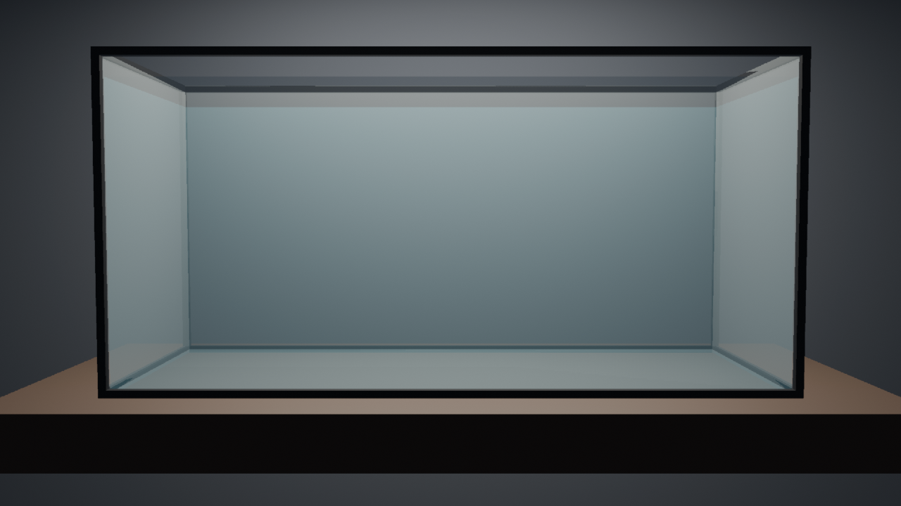

# tankful

A desktop aquarium built on the [UPBGE](https://upbge.org) game engine:
a glass tank of fish that swim, school and react, with lighting that can
follow the weather, the moon, your battery or the stock market.

This is the project skeleton: an empty glass tank, the launcher and the
test harness.

## Setup

Python 3.11 or later runs the launcher and tools (this repository is
also a venv; any Python works).  The game itself runs in UPBGE's own
bundled Python.

Download UPBGE 0.50 (about 650 MB on macOS, 400 MB on Linux) into
`vendor/upbge/`, checked against the release's published size and
sha256:

    python tools/fetch_upbge.py                    # this OS
    python tools/fetch_upbge.py --platform linux   # for the docker backend

On macOS the dmg is mounted and its apps copied out.  To use an UPBGE
installed elsewhere, set `TANKFUL_UPBGE` to its directory, app bundle or
binary.  Otherwise the launcher looks in `vendor/upbge/<os>/`, then in
`/Applications/UPBGE`, `~/Applications/UPBGE`, `/opt/upbge`, `~/upbge`
or `%ProgramFiles%\UPBGE`.

## Running

    python run_tankful.py

This rebuilds `build/tankful.blend` from `tools/build_scene.py` when it
is missing or older than that script, then starts the UPBGE player.
Escape quits.  Options:

- `--rebuild`: rebuild the scene even if up to date.
- `--backend offscreen|xvfb|docker`: run without a visible window (see
  [docs/harness.md](docs/harness.md)).
- `--harness PORT`: accept harness commands on localhost:PORT.
- `--debug`: debug game code in Wing.  Copy `wingdbstub.py` from your
  Wing install into the project root first.

In Wing, `run_tankful.py` is the main entry point, and `build-scene` and
`harness` are named entry points.

## Harness and tests

    python tools/harness.py tools/scripts/01-skeleton.json

This drives the game with clicks, keys, waits, screenshots and state
checks, off screen.  It saves `docs/shots/01-skeleton.png`.  See
[docs/harness.md](docs/harness.md) for the commands, the display
backends, and which of them work where.

Unit tests use unittest and need no UPBGE:

    python -m unittest discover -s tests -t .

## Layout

- `tankful/sim/`: the simulation, in plain standard-library Python that
  runs under both the venv and UPBGE's Python 3.11.
- `tankful/game/`: thin adapters to UPBGE's `bge`: the per-frame update,
  the input layer, the harness channel and off-screen window handling.
- `tankful/factors/`: external data sources (still to come).
- `tankful/launcher.py`, `run_tankful.py`: find UPBGE, build the scene
  and start the player.
- `tankful/harness_*.py`, `tools/harness.py`: the test harness.
- `tools/build_scene.py`: generates the scene; it runs under
  `blender -b`.
- `tools/fetch_upbge.py`: downloads UPBGE.
- `tools/docker/`: the headless Linux container.
- `vendor/` and `build/`: downloads and generated files, not in git.
