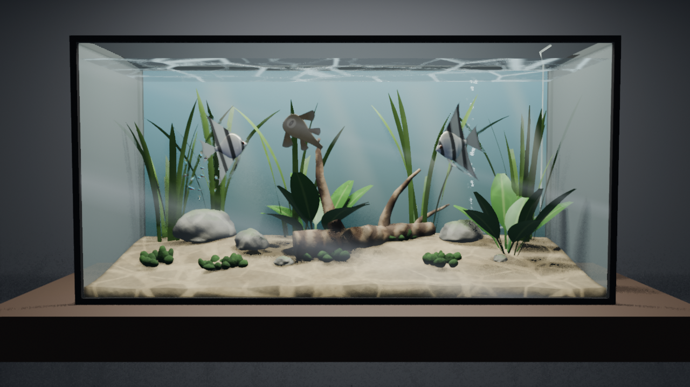

# tankful

A desktop aquarium built on the [UPBGE](https://upbge.org) game engine:
a glass tank of fish that swim, school and react, with lighting that can
follow the weather, the moon, your battery or the stock market.

So far there is the tank and its first fish.  The tank has a sloping
sand bed, rocks and driftwood, swaying vallisneria, Amazon swords and
moss, an airstone's bubble stream, moving caustics with a shimmering
surface, and soft god rays.  Two angelfish glide slowly around the
decor, bank into turns, and now and then hover on their fins.  A school
of fifteen neon tetras swims as one through the open water: it turns
together, flows round the decor, and now and then one of them flicks
aside and darts back.  A bristlenose pleco clings to the front glass
with its belly to the viewer, its sucker mouth rasping as it inches
along; now and then it lets go, darts to another spot on the glass, a
rock or the sand, and clings again.  Then there are the launcher and
the test harness.

## Setup

Python 3.11 or later runs the launcher and tools (this repository is
also a venv; any Python works).  The game itself runs in UPBGE's own
bundled Python.

Download UPBGE 0.50 (about 650 MB on macOS, 400 MB on Linux) into
`vendor/upbge/`, checked against the release's published size and
sha256:

    python tools/fetch_upbge.py                    # this OS
    python tools/fetch_upbge.py --platform linux   # for the docker backend

On macOS the dmg is mounted and its apps copied out.  To use an UPBGE
installed elsewhere, set `TANKFUL_UPBGE` to its directory, app bundle or
binary.  Otherwise the launcher looks in `vendor/upbge/<os>/`, then in
`/Applications/UPBGE`, `~/Applications/UPBGE`, `/opt/upbge`, `~/upbge`
or `%ProgramFiles%\UPBGE`.

## Running

    python run_tankful.py

This rebuilds `build/tankful.blend` from `tools/build_scene.py` when it
is missing or older than that script or the other sources it is made
from (`launcher.SCENE_SOURCES`), then starts the UPBGE player.
Escape quits.  Options:

- `--rebuild`: rebuild the scene even if up to date.
- `--backend offscreen|xvfb|docker`: run without a visible window (see
  [docs/harness.md](docs/harness.md)).
- `--harness PORT`: accept harness commands on localhost:PORT.
- `--debug`: debug game code in Wing.  Copy `wingdbstub.py` from your
  Wing install into the project root first.

In Wing, `run_tankful.py` is the main entry point, and `build-scene` and
`harness` are named entry points.

## Harness and tests

    python tools/harness.py tools/scripts/05-sucker.json

This drives the game with clicks, keys, waits, screenshots and state
checks, off screen.  It saves `docs/shots/05-sucker.png`.  See
[docs/harness.md](docs/harness.md) for the commands, the display
backends, and which of them work where.

Unit tests use unittest and need no UPBGE:

    python -m unittest discover -s tests -t .

## Layout

- `tankful/sim/`: the simulation, in plain standard-library Python that
  runs under both the venv and UPBGE's Python 3.11.  `environment.py`
  is the tank's layout, which the scene build and the game share;
  `bubbles.py` and `sway.py` drive the bubble stream and the plants.
  `fish.py` is the fish agent (wandering, avoiding the glass and decor,
  speed, turn, pitch and bank limits, hovering), `school.py` schools
  (a group with a wandering goal, and members that follow the boids
  rules and flick), and `swim.py` the body wave of a swimming fish.
  `species/` has a module per species, with its build and gait, who of
  it lives in the tank and its rig's pose: `angelfish.py`,
  `neon_tetra.py`, and `pleco.py`, the glass sucker (the surfaces it
  clings to, and its attach and detach state machine).  Its
  `__init__.py` is the registry of species, which the sim, the game and
  the scene build all read; see [docs/species.md](docs/species.md) for
  adding one.
- `tankful/game/`: thin adapters to UPBGE's `bge`: the per-frame update,
  the scenery animation (`scenery.py`), the fish rigs (`fishes.py`),
  the input layer, the harness
  channel and off-screen window handling.
- `tankful/factors/`: external data sources (still to come).
- `tankful/launcher.py`, `run_tankful.py`: find UPBGE, build the scene
  and start the player.
- `tankful/harness_*.py`, `tools/harness.py`: the test harness.
- `tools/build_scene.py`: generates the scene; it runs under
  `blender -b`.  `tools/scene_env.py` makes the environment in it:
  sand, decor, plants, bubbles and the light effects.
  `tools/scene_fish.py` makes the rigged fish models, each species' from
  its own builder in `tools/species/` (`angelfish.py`; `neon_tetra.py`,
  each school as one object; and `pleco.py`), with the lofting and
  materials they share.
- `tools/fetch_upbge.py`: downloads UPBGE.
- `tools/docker/`: the headless Linux container.
- `vendor/` and `build/`: downloads and generated files, not in git.
